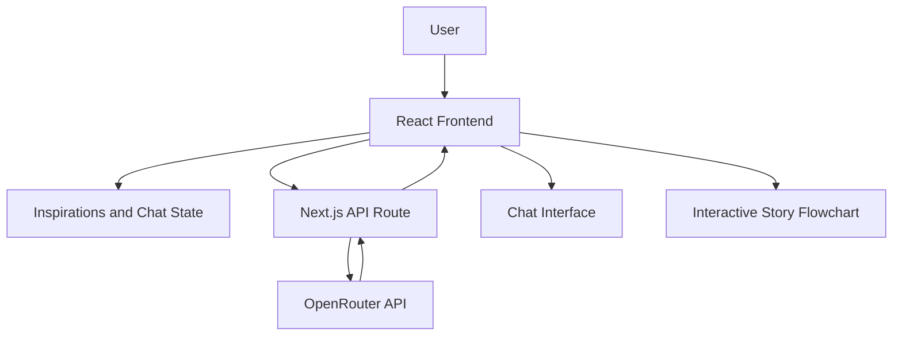

# Ilhum

**An AI-powered creative writing and story development workspace.**

Ilhum is a web-based creative workspace designed to help writers transform scattered inspirations into structured stories. It combines inspiration collection, AI-assisted brainstorming, character generation, and interactive story flowcharts to support the creative process from initial idea to narrative planning.

## 1. Problem

Story ideas often come from scattered sources, such as notes, links, documents, and conversations. Keeping these inspirations organized while developing characters, plots, and story structures can make the creative process difficult.

Ilhum aims to bring these elements into one workspace, allowing users to collect inspirations, interact with an AI story assistant, generate character profiles, and visualize narrative structures.

## 2. Architecture

Ilhum uses a frontend-backend architecture within a Next.js application.



- **Frontend:** Handles the user interface, inspiration collection, conversation state, and flowchart visualization.
- **API Route:** Receives requests from the frontend, prepares the prompt and context, and communicates with the AI provider.
- **AI Provider:** OpenRouter is used to request AI-generated responses.
- **Flowchart:** AI-generated story structures are converted into nodes and edges for visualization.

## 3. Tech Stack

| Technology | Purpose |
|---|---|
| TypeScript | Application logic and type safety |
| React | Interactive user interface |
| Next.js | Application framework and API routes |
| React Flow (@xyflow/react) | Interactive flowchart visualization |
| OpenRouter API | AI model communication |
| CSS | Interface styling |
| npm | Dependency management |

## 4. Running Ilhum Locally

### Prerequisites

- Node.js
- npm
- OpenRouter API key

### Installation

```bash
git clone https://github.com/ahadcs20-byte/Ilhum.git
cd Ilhum
npm install
```

### Environment Setup

Create a `.env.local` file in the root directory:

```env
OPENROUTER_API_KEY=your_api_key_here
```

### Run the Application

```bash
npm run dev
```

Open http://localhost:3000 in your browser.

### Available Commands

| Command | Description |
|---|---|
| `npm run dev` | Start the development server |
| `npm run build` | Build the application |
| `npm run start` | Start the production server |
| `npm run lint` | Run ESLint |

## 5. Usage

### Collect Inspirations

- Add textual inspirations.
- Add URL-based inspirations.
- Upload supported text-based documents.
- Remove inspirations from the workspace.

### AI Story Development

- Send prompts to the AI story assistant.
- Use collected inspirations as contextual input.
- Continue story development through conversational interaction.

### Character Generation

Generate character profiles based on the ongoing conversation and collected inspirations.

### Story Flowchart

Generate a visual representation of a story structure using AI-generated nodes and connections, displayed through an interactive flowchart.

## 6. Challenges and Limitations

Ilhum is currently an evolving personal project. Its current implementation has several areas that require further development:

- **State management:** Inspirations, messages, and flowchart state are currently managed in frontend state rather than persistent storage.
- **AI response handling:** AI-generated content depends on API responses and requires handling malformed or unexpected output.
- **Flowchart generation:** AI-generated flowchart data must follow a format that can be parsed and rendered by the application.
- **Scalability and maintainability:** The current implementation is relatively concentrated within the main frontend page and could benefit from modularization.
- **Testing:** Automated tests have not yet been implemented.

These limitations represent areas for future improvement rather than problems that have already been resolved.

## 7. Next Steps

- Refactor the frontend into reusable components and modules.
- Introduce persistent storage for inspirations, conversations, and story flowcharts.
- Improve validation and error handling for AI-generated content.
- Implement automated testing.
- Improve flowchart editing and story organization.
- Explore export and project-management functionality.

---

Ilhum is an ongoing personal project focused on exploring AI-assisted creative workflows, frontend development, API integration, and interactive story visualization.
